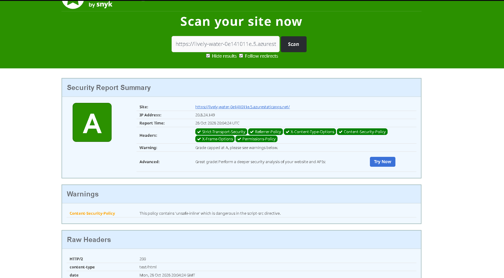

# Despliegue de PokeDex en Azure Static Web Apps

Este documento explica paso a paso cómo se desplegó la aplicación **PokeDex** (Angular) en Azure, cómo se configuraron los encabezados de seguridad y qué problemas aparecieron en el camino.

-   **URL pública:** https://lively-water-0e141011e.5.azurestaticapps.net/
-   **Repositorio:** https://github.com/AlejandroPae/pokedex
-   **Creación de la cuenta y recursos en Azure:** ver [README.md](https://claude.ai/chat/README.md)

----------

## 1. Requisitos previos

-   Cuenta de Azure con una Static Web App creada.
-   Cuenta de GitHub y repositorio `pokedex`.
-   Git, Node.js y npm instalados en el computador.
-   Código fuente de PokeDex clonado o copiado en el repositorio.

----------

## 2. Preparar el repositorio

1.  Descargar el código fuente de PokeDex (proyecto `pokedex-angular`) y subirlo al repositorio `pokedex` en GitHub, rama `main`.
2.  Verificar que el proyecto compila en local:

```powershell
npm install
npm run build

```


----------

## 3. Despliegue con GitHub Actions

Al crear la Static Web App en Azure y conectarla con el repositorio, Azure agregó un workflow en `.github/workflows/` llamado **Azure Static Web Apps CI/CD**. Este workflow compila la aplicación y la publica en Azure cada vez que se hace `git push` a `main`.

Parámetros de compilación usados:

Parámetro

Valor

`app_location`

`/`

`output_location`

`dist/pokedex-angular`

Rama

`main`

Plan

Free

Para desplegar un cambio:

```powershell
git add .
git commit
git push

```
----------

## 4. Problema 1: las imágenes no cargaban

**Problema:** la aplicación abría, pero las ,imágenes de los Pokémon no aparecían.

**Evento:** en las herramientas de desarrollador del navega, la petición `pokemon-green.png` devolvía **404**. La ruta solicitada era `/pokedex-angular/assets/images/pokemon-green.png`, pero en Azure la aplicación está en la raíz del dominio, no en la subcarpeta `/pokedex-angular/` Abrir `/assets/images/pokemon-green.png` sí mostraba la imagen, lo que confirmó que el archivo estaba publicado y la ruta era el problema.

**Solución:** en `src/environments/environment.prod.ts` se cambió:

```ts
// Antes
imagesPath: '/pokedex-angular/assets/images',

// Después
imagesPath: '/assets/images',

```

----------

## 5. Encabezados de seguridad

Para cumplir los requisitos de seguridad de Pueblo Paleta Inc. se agregó el archivo `src/staticwebapp.config.json`, que Azure Static Web Apps lee para añadir encabezados HTTP a todas las respuestas.

### 5.1 Archivo `src/staticwebapp.config.json`

```json
{
  "navigationFallback": {
    "rewrite": "/index.html",
    "exclude": ["/assets/*", "*.{css,js,png,jpg,gif,svg,ico,woff,woff2}"]
  },
  "globalHeaders": {
    "Content-Security-Policy": "default-src 'self'; img-src 'self' data: https://assets.pokemon.com; style-src 'self' 'unsafe-inline' https://fonts.googleapis.com; font-src 'self' https://fonts.gstatic.com; script-src 'self' 'unsafe-inline'; connect-src 'self' https://beta.pokeapi.co https://pokeapi.co; object-src 'none'; base-uri 'self'; frame-ancestors 'none'; form-action 'self'",
    "Strict-Transport-Security": "max-age=31536000; includeSubDomains; preload",
    "X-Frame-Options": "DENY",
    "X-Content-Type-Options": "nosniff",
    "Referrer-Policy": "strict-origin-when-cross-origin",
    "Permissions-Policy": "camera=(), microphone=(), geolocation=(), payment=()",
    "Cross-Origin-Opener-Policy": "same-origin",
    "Cross-Origin-Resource-Policy": "same-origin"
  }
}

```

### 5.2 Incluir el archivo en el build

Para que Angular copie el archivo a la carpeta publicada, se agregó a la lista `assets` de la sección `build` en `angular.json`:

```json
"assets": ["src/favicon.ico", "src/og-image.jpg", "src/assets", "src/404.html", "src/staticwebapp.config.json"],

```

### 5.3 Qué hace cada encabezado

Encabezado

Función

`Content-Security-Policy`

Define desde qué orígenes se pueden cargar scripts, estilos, imágenes y peticiones. Mitiga XSS.

`Strict-Transport-Security`

Obliga al navegador a usar siempre HTTPS.

`X-Frame-Options`

Impide que el sitio se cargue dentro de un iframe (clickjacking).

`X-Content-Type-Options`

Evita que el navegador "adivine" el tipo de contenido.

`Referrer-Policy`

Limita la información de origen enviada a otros sitios.

`Permissions-Policy`

Desactiva APIs del navegador que la app no usa (cámara, micrófono, geolocalización).

`Cross-Origin-Opener-Policy` / `Cross-Origin-Resource-Policy`

Aíslan el sitio de otros orígenes.

### 5.4 Ajustes del CSP por dominios que usa la aplicación

La primera versión del CSP bloqueó partes de la aplicación. Cada bloqueo se detectó en la consola del navegador (F12 → Console) y se corrigió agregando solo el dominio necesario:

Error en consola

Causa

Corrección

Las peticiones a la API fallaban y la app mostraba "500 Internal server error"

La aplicación consulta datos a `https://beta.pokeapi.co/graphql/v1beta`, bloqueado por `connect-src 'self'`

`connect-src 'self' https://beta.pokeapi.co https://pokeapi.co`

_Executing inline script violates ... script-src 'self'_

`index.html` y Angular usan scripts y manejadores en línea

`script-src 'self' 'unsafe-inline'`

_Loading the image 'https://assets.pokemon.com/...' violates ... img-src_

La página de detalle carga el arte oficial desde `assets.pokemon.com`

`img-src 'self' data: https://assets.pokemon.com`

Para comprobar qué encabezado sirve Azure realmente:

```powershell
(Invoke-WebRequest https://lively-water-0e141011e.5.azurestaticapps.net/ -UseBasicParsing).Headers["Content-Security-Policy"]

```

### 5.5 Subir los cambios

El proyecto tiene husky y lint-staged, que ejecutan ESLint antes de cada commit. ESLint no sabe interpretar archivos `.json` y marcaba un error de parseo en `staticwebapp.config.json`, aunque el archivo era válido. Por eso estos commits se hicieron saltando el hook:

```powershell
git add .
git commit --no-verify
git push

```

----------

## 6. Resultados de seguridad

### 6.1 SecurityHeaders.com

Escaneo de https://lively-water-0e141011e.5.azurestaticapps.net/ → **calificación A**.

Encabezados detectados: `Strict-Transport-Security`, `Referrer-Policy`, `X-Content-Type-Options`, `Content-Security-Policy`, `X-Frame-Options` y `Permissions-Policy`.

La única advertencia es que el CSP contiene `'unsafe-inline'` en `script-src`, lo que limita la nota a A (no A+). Para llegar a A+ habría que eliminar los scripts en línea del `index.html` y del código generado por Angular. Se decidió dejar la calificación en A para no arriesgar el funcionamiento de la aplicación.

📷 _Captura:  

### 6.2 SSL Labs (revisión adicional)


----------

## 7. Verificación final

-   [x] La aplicación abre en la URL pública.
-   [x] La lista de Pokémon carga con sus sprites.
-   [x] La página de detalle muestra la imagen grande.
-   [x] No hay errores de CSP en la consola del navegador. `[COMPLETAR: confirmar]`
-   [x] SecurityHeaders.com: calificación A.
-   [x ] SSL Labs: 


